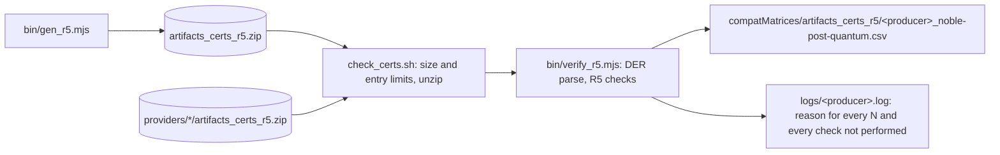

# noble-post-quantum

R5 certificate artifacts and an R5 verifier written in JavaScript on
[@noble/post-quantum](https://github.com/paulmillr/noble-post-quantum) 0.7.1 (MIT). The runtime
dependencies are that package and its own dependency @noble/hashes 2.4.0 (MIT); DER is written by
`lib/der.mjs` and read by `bin/verify_r5.mjs`.

This is tooling for the interoperability tests of this project, not a validated cryptographic
module. The @noble/post-quantum README states that the library has not been independently audited.



## What it produces

`artifacts_certs_r5.zip` holds 54 files, flat, DER, named as in the readme (*Zip Format (R5)*):

| OIDs | Files |
|---|---|
| ML-DSA-44/65/87 `2.16.840.1.101.3.4.3.17–19` | `<friendly>-<oid>_ta.der` (self-signed), `_seed_priv.der`, `_expandedkey_priv.der`, `_both_priv.der` |
| ML-KEM-512/768/1024 `2.16.840.1.101.3.4.4.1–3` | `_ee.der` signed by the ML-DSA-44/65/87 TA, the same three key forms, `_ciphertext.bin`, `_ss.bin` |
| SLH-DSA SHA2/SHAKE 128/192/256 s/f `2.16.840.1.101.3.4.3.20–31` | `_ta.der` (self-signed), `_priv.der` |

- Certificates: v3; AlgorithmIdentifier parameters absent; pure signatures with the empty context
  over the DER `TBSCertificate` (RFC 9881, RFC 9909); a distinct subject DN per TA; validity of
  20 years.
- Trust anchors: basicConstraints `CA:TRUE` (critical), keyUsage digitalSignature, keyCertSign and
  cRLSign (critical), SubjectKeyIdentifier (SHA-1 of the public key, RFC 5280 method 1),
  AuthorityKeyIdentifier equal to the SKI.
- ML-KEM end-entity certificates: keyUsage keyEncipherment only (critical, RFC 9935), SKI, and the
  TA's SKI as AuthorityKeyIdentifier; the issuer is the TA's subject, byte for byte.
- Private keys: `OneAsymmetricKey` version 0 without `publicKey`. ML-DSA and ML-KEM use the seed /
  expandedKey / both CHOICE of RFC 9881 and RFC 9935 (seed of 32 and 64 bytes); SLH-DSA puts the
  raw private key in the `privateKey` OCTET STRING (RFC 9909).
- `make generate` writes new keys every time. `R5_TEST_SEED=<hex>` makes the output reproducible
  (used by the tests only).

Before it was committed, the zip was checked with:

| Check | Result |
|---|---|
| this verifier (`make verify`) | 66 rows, all `Y` |
| `src/test_certs_r5_openssl.sh` (the CI job), OpenSSL 3.5.8 on AlmaLinux 9.8 | 66 rows, all `Y` |
| the same script in `fedora:43` with OpenSSL 3.5.9, as in CI | 66 rows, all `Y` |
| `openssl verify -x509_strict` (TA self-signature; each EE against its TA) | OK |
| pkilint 0.13.4 `lint_pkix_cert` | no error or warning |

## How to run

Requires Node.js 20.19 or later (tested with 22.23.2), npm, `zip` and `unzip`.

```sh
make install       # npm ci
make test          # unit tests and the RFC 9881 / 9935 / 9909 example vectors (node --test)
make generate      # rewrites artifacts_certs_r5.zip with new keys
make verify        # checks our zip -> compatMatrices/artifacts_certs_r5/noble-post-quantum_noble-post-quantum.csv
make cross_verify  # checks ../*/artifacts_certs_r5.zip -> compatMatrices/artifacts_certs_r5/<producer>_noble-post-quantum.csv
make unzip         # extracts our zip into artifacts_certs_r5/ (ignored by git)
```

`./check.sh [<provider-dir>|<zip>]` checks one zip; `./check_certs.sh <zip>` prints the CSV on
stdout and the reasons on stderr. `cross_verify` reads `$(PROVIDERS_DIR)/*/artifacts_certs_r5.zip`
(default `..`), skips a zip it cannot read, and writes nothing into other providers' directories.

## What the verifier checks

Each row follows the R5 definitions in `docs/compat_matrix_instructions.md`.

| Algorithms | Rows |
|---|---|
| ML-DSA | `seed`, `expandedkey`, `both`: the key parses as the RFC 9881 CHOICE named by the file (in `both` the seed and the expanded key must agree; an `expandedkey` must have the t0 and tr that ρ, s1 and s2 give, as OpenSSL 3.5 checks on import), and a signature made with it verifies under the key's public key. `cert`: the TA's self-signature verifies. `consistent` |
| SLH-DSA | `priv`: the raw private key (RFC 9909) parses and a signature made with it verifies. `cert`. `consistent` |
| ML-KEM | `seed`, `expandedkey`, `both`: the key parses (RFC 9935 CHOICE) and decapsulates `_ciphertext.bin` to `_ss.bin`. `cert`: the EE's signature verifies under the ML-DSA TA of the same level (ML-KEM-512/768/1024 with ML-DSA-44/65/87). `consistent` |

- `consistent`: every key form that parses gives the same public key, which is also the
  certificate's. A `both` form whose seed and expanded key disagree makes it `N`. The row is written
  when there are at least two keys, or a key and a certificate.
- A row is written only for a check that ran. Not performed, and so not written: ML-KEM key rows
  when the set does not hold exactly one `_ciphertext.bin` and one `_ss.bin` (a malformed key is
  still `N`); an EE `cert` row when the set has no ML-DSA TA of the same level (a TA that is present
  but does not verify makes the EE `N`).
- Parsing: a certificate must be `SEQUENCE { tbsCertificate, signatureAlgorithm, signature }` with
  the TBSCertificate fields of RFC 5280 in order, a version of v1 to v3 and no extension twice;
  AlgorithmIdentifier parameters must be absent and OIDs minimally encoded (X.690 8.19.2). The
  ML-DSA / ML-KEM private key CHOICE must be DER (RFC 9881 / RFC 9935 Sec. 6); the outer
  OneAsymmetricKey may be BER (RFC 5958), and a non-minimal length in a certificate is only a
  warning (OpenSSL accepts it too).
- Files are found by name in any folder of the zip; symbolic links are not followed, and
  `__MACOSX` folders and `._*` files are ignored. Files whose name starts with `external_`,
  `catalyst_` or `chameleon_` are ignored, as in the CI scripts. If two files match the same OID
  and form, that form is skipped with a warning.
- Validity dates are not part of the R5 `cert` test (the CI job runs `openssl verify -no_check_time`):
  an expired certificate whose signature verifies is `Y`, with a warning. `VERIFY_TIME=<ISO 8601>`
  requires validity at that time.
- An EE issuer name that differs from the TA subject is a warning only; the R5 test is the signature.
- Not covered (no rows): HashML-DSA, HashSLH-DSA, composite and other OIDs.
- A zip over 64 MiB, with more than 4096 entries, with a symbolic link or with the same path
  twice is refused before any entry is read. Extraction never reads stdin, stops any file at
  16 MiB, and the extracted total may not exceed 256 MiB (the sizes a zip declares are not
  trusted).

The example certificates and keys of RFC 9881, RFC 9935 and RFC 9909 (Appendix C, including the
invalid keys) are in `test/vectors/` and run with `make test`; `test/vectors/README.md` gives their
sources and the IETF Trust licence that applies to them. `bin/extract_rfc_vectors.mjs` rebuilds them
from the RFC text, and `test/openssl_kat_check.sh` checks the same vectors with OpenSSL 3.5.

Where this differs from the OpenSSL job in CI (`src/test_certs_r5_openssl.sh`): for an ML-KEM EE the
job parses the certificate and encapsulates to its key, and does not check the EE's signature; here
`cert` is the signature by the same-level ML-DSA TA, as `docs/compat_matrix_instructions.md` defines it.

## Results at master `4cd2d1e` (2026-11-14)

`make cross_verify` over the 21 zips: 18 of them hold rows for the OIDs above; 722 rows, 705 `Y`
and 17 `N`. Compared row by row with the CSVs the other verifiers committed, 720 rows agree with
the majority and 2 differ:

| Producer | Rows | Here | Others | Reason (from `logs/`) |
|---|---|---|---|---|
| sanctum-secops-llc | ML-KEM-768 EE `cert` | N | Y (cryptonext, go-crypto) | the EE's signature does not verify under the set's ML-DSA-65 TA |
| sanctum-secops-llc | ML-KEM-1024 EE `cert` | N | Y (cryptonext, go-crypto) | the EE is signed with ML-DSA-65, not with the ML-DSA-87 TA of its level |

The other `N` rows agree with the majority: botan's ML-DSA `seed` keys (3) do not parse as the
RFC 9881 CHOICE, and seventhsense.ai's ML-DSA key files (9) do not parse as single DER objects of
that form, and its ML-KEM EE signatures (3) do not verify under the TAs of the same level.

## Licence

Apache-2.0 (see `LICENSE`). @noble/post-quantum and its dependencies are MIT. The RFC example
vectors in `test/vectors/` are under the IETF Trust's Revised BSD licence (see the README there).
